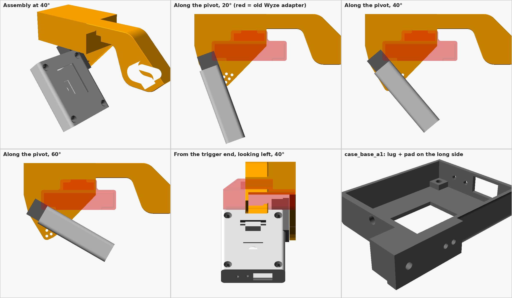
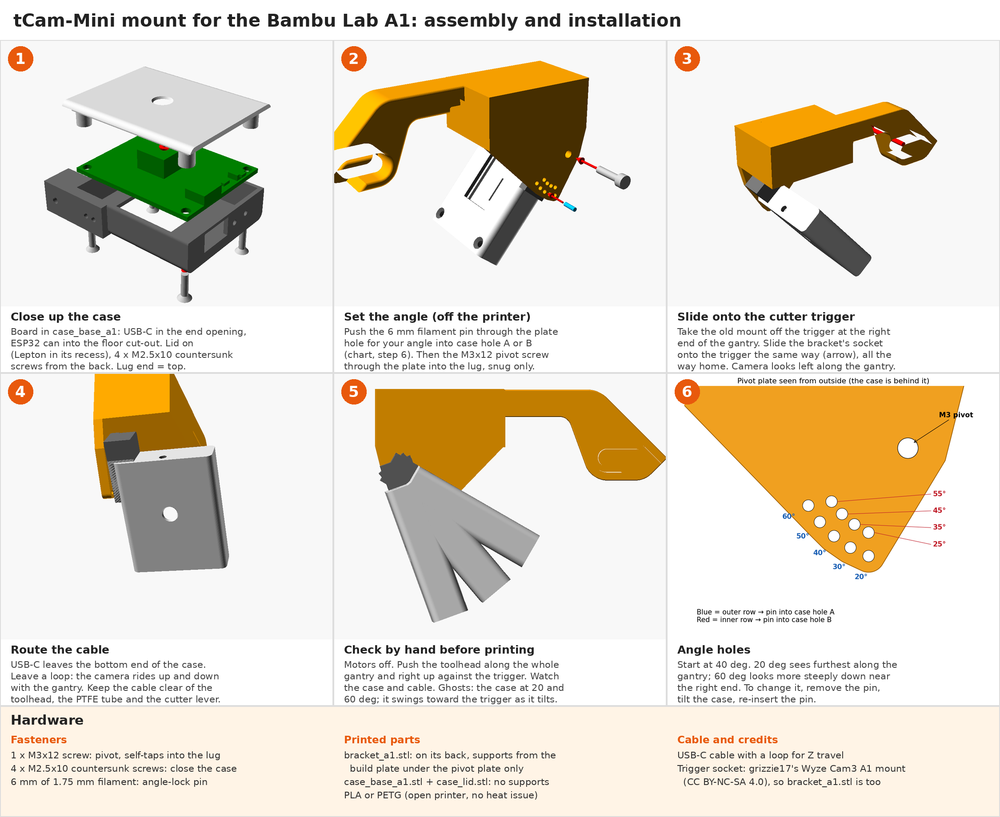

# tCam-Mini mount for a Bambu Lab A1 (not mini)

This is the A1 companion to [tcam-p1s-mount](https://github.com/yaturner/tcam-p1s-mount). It uses the same case and the same pin-locked tilt. `tcam_p1s_mount.scad` is a copy of that project's source, used here for the case modules.

This mount holds a tCam-Mini (Rev 4, Lepton 3.5) on the A1's **filament-cutter trigger** at the right end of the gantry. The camera rides up with the gantry, so it stays the same distance from the layer being printed. It looks left along the gantry and down at the print.

The mount is one rigid printed bracket. The case tilts on an M3 pivot and is locked at 20–60° in 5° steps by a 1.75 mm filament pin, so there is no GoPro swivel or slide-in rail to wobble.

## Assembly and installation

Printable version (US Letter, landscape): [a1_assembly.pdf](docs/a1_assembly.pdf)

## Parts

| File | Qty | Notes |
|---|---|---|
| `stl/bracket_a1.stl` | 1 | Print as exported, on its back. **Use supports, from the build plate only**, under the pivot plate, which sits on top. |
| `stl/case_base_a1.stl` | 1 | Back face down, no supports. This is the P1S case base plus a pivot lug and pad on one long side. |
| `stl/case_lid.stl` | 1 | The same lid as the P1S version. |

Print in PLA or PETG: the A1 is open, so heat isn't a problem.

## Hardware

- 1 × **M3×12** screw for the pivot. It goes through the bracket plate and self-taps 7–8 mm into the case lug.
- 4 × M2.5×10 countersunk screws to close the case, as on the P1S.
- **6 mm** of 1.75 mm filament for the angle-lock pin.
- USB-C cable. It leaves the case at the bottom end, so give it a loop for the gantry's up-and-down travel.

## Angle stops (tilt below horizontal)

| Stop | Pin goes in |
|---|---|
| 20°, 30°, 40°, 50°, 60° | the outer row of plate holes (5 holes) and case hole **A** (outer) |
| 25°, 35°, 45°, 55° | the inner row (4 holes) and case hole **B** (inner) |

Start at about 40°.

## Fitting

1. Put the board in `case_base_a1` and close it with the lid and the M2.5 screws.
2. Push the pin through the plate hole for your angle into hole A or B, then fit the M3 pivot through the plate into the lug. Tighten it until the case is snug.
3. Take your old mount off the cutter trigger and slide the bracket on the same way.
4. **Before printing,** turn the motors off and push the toolhead by hand along the whole gantry, including all the way right against the cutter trigger. Watch the camera and the cable the whole way.

## How it was sized

There's no published 3D model of the A1 gantry or toolhead, so clearance with the toolhead could **not** be checked numerically. Instead, the camera stays inside the space the previous Wyze/GoPro camera used, which has run through color changes, including filament cuts, without hitting anything.

What was checked against the models:
- At every stop from 20° to 60°, nothing overlaps between the case and the bracket. The pivot gap is 0.3 mm, and the case top is 2.2 mm below the bracket.
- The case's lowest point is 61 mm below the top of the cutter trigger socket, at 20°. The old camera's lowest point was about 64 mm below, estimated from photos.
- Front to back, the case and plate extend about 1 mm past each end of the old Wyze adapter.

## Credits and license

The bracket's trigger socket and arm are **grizzie17's "Wyze Cam3 Mount for A1 (not Mini)"** interface part. It is licensed **CC BY-NC-SA 4.0**, and is used unchanged except that its Wyze rail is cut off. Because of that, **`stl/bracket_a1.stl` is CC BY-NC-SA 4.0**: credit grizzie17, non-commercial use only, share alike.

The `.scad` file doesn't contain their geometry. It imports their STL, which you need to download yourself. Set `interface_stl` to where you saved it.

Everything else is MIT (see [LICENSE](LICENSE)): the case, `tcam_a1_mount.scad` and `tcam_p1s_mount.scad`.
